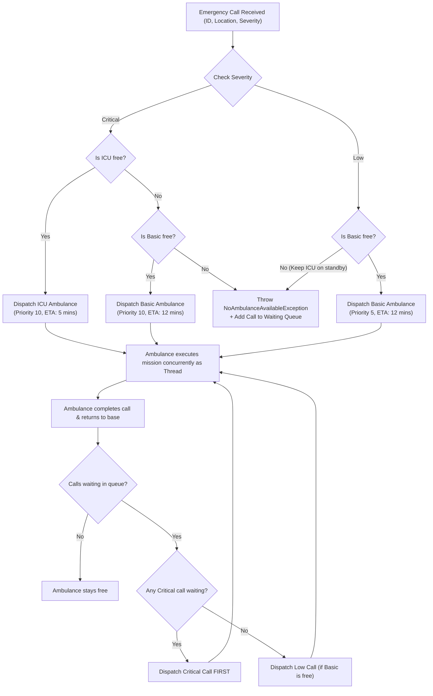
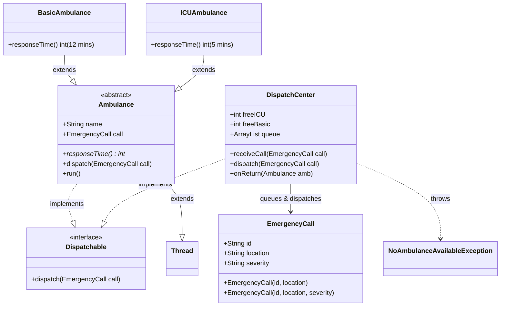

# City Ambulance Dispatch System (P15)

A city emergency response service that dispatches ambulances based on medical severity and real-time fleet availability.

---

## How We Approached This

1. **Smart Medical Triage**:
   - **Critical emergencies** need rapid response and intensive care equipment: they dispatch an **ICU Ambulance** (5 mins ETA). If all ICU units are busy, they fall back to a **Basic Ambulance**.
   - **Low-severity calls** dispatch **ONLY Basic Ambulances** (12 mins ETA). ICU units are never wasted on minor cases, keeping them free for life-threatening events.

2. **Multithreading & Priority Scheduling**:
   - Each ambulance runs as an independent concurrent **`Thread`**.
   - Critical calls assign `Thread.MAX_PRIORITY` (10) to give urgent calls higher CPU execution preference.

3. **Queueing & Event-Driven Re-dispatch**:
   - If no suitable ambulance is available, a custom **`NoAmbulanceAvailableException`** is thrown, and the call is placed in a waiting queue.
   - The moment an ambulance returns to base, it alerts the center. The center scans the queue and **dispatches Critical calls first** before attending to Low-priority cases.

---

## Visual Dispatch Flow



---

## Class Architecture



---

## Project Files (`src/emergency/`)

| File | Purpose |
| :--- | :--- |
| [`EmergencyCall.java`](file:///d:/Projects/JavaMiniProject/src/emergency/EmergencyCall.java) | Constructor Overloading (`id`, `location`, `severity`). |
| [`Dispatchable.java`](file:///d:/Projects/JavaMiniProject/src/emergency/Dispatchable.java) | Interface in package `emergency`. |
| [`NoAmbulanceAvailableException.java`](file:///d:/Projects/JavaMiniProject/src/emergency/NoAmbulanceAvailableException.java) | Custom checked exception when fleet cannot fulfill a call. |
| [`Ambulance.java`](file:///d:/Projects/JavaMiniProject/src/emergency/Ambulance.java) | Abstract class extending `Thread` and implementing `Dispatchable`. |
| [`BasicAmbulance.java`](file:///d:/Projects/JavaMiniProject/src/emergency/BasicAmbulance.java) | Concrete subclass; overrides `responseTime()` (12 mins). |
| [`ICUAmbulance.java`](file:///d:/Projects/JavaMiniProject/src/emergency/ICUAmbulance.java) | Concrete subclass; overrides `responseTime()` (5 mins). |
| [`DispatchCenter.java`](file:///d:/Projects/JavaMiniProject/src/emergency/DispatchCenter.java) | Central service handling triage, queueing, and priority re-allocation. |
| [`Main.java`](file:///d:/Projects/JavaMiniProject/src/emergency/Main.java) | Interactive console menu and automated flow test. |

---

## How to Compile & Run

```powershell
javac -d bin src/emergency/*.java
java -cp bin emergency.Main
```
